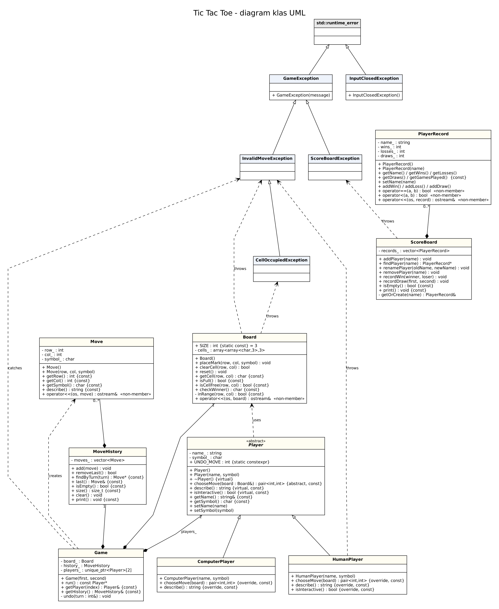

# Kółko i krzyżyk (C++)

Konsolowa gra w kółko i krzyżyk – projekt zaliczeniowy z przedmiotu *Podstawy programowania obiektowego w C++*.


## Funkcjonalność

- Gra **człowiek vs człowiek** oraz **człowiek vs komputer** (komputer wybiera losowe wolne pole).
- **Cofanie ruchu** – wpisanie `0 0` zamiast współrzędnych cofa ostatni ruch (w grze z komputerem cofane są dwa ruchy, aby gracz mógł zagrać ponownie).
- **Historia ruchów** – po każdej partii program wypisuje wszystkie ruchy i pozwala wyszukać ruch po numerze tury.
- **Tablica wyników** – lista graczy z liczbą wygranych, przegranych i remisów, posortowana od najlepszego gracza. Operacje: dodawanie, wyszukiwanie, zmiana nazwy i usuwanie gracza. Wyniki partii zapisują się automatycznie.
- Odporność na błędne dane: litery zamiast liczb, współrzędne poza planszą, zajęte pole, powtórzona nazwa gracza.

## Kompilacja i uruchomienie

Wymagany jest kompilator obsługujący **C++17** (g++ 9 lub nowszy).

### Windows (MSYS2 / MinGW)

1. Zainstaluj [MSYS2](https://www.msys2.org/) i w konsoli *MSYS2 UCRT64* wykonaj:
   `pacman -S --needed base-devel mingw-w64-ucrt-x86_64-toolchain`
2. Dodaj `C:\msys64\ucrt64\bin` do zmiennej środowiskowej `Path` i otwórz nowy terminal.
3. W katalogu projektu:

```
g++ -std=c++17 -Wall -Wextra src/*.cpp -o tictactoe.exe
.\tictactoe.exe
```

(Alternatywnie, po zainstalowaniu `mingw-w64-ucrt-x86_64-make`: `mingw32-make`.)

### Linux / macOS

```
make
./tictactoe
```

Usunięcie plików skompilowanych: `make clean`.

## Sterowanie

W menu głównym wybierz numer opcji. W trakcie gry podaj **wiersz i kolumnę** (1–3) oddzielone spacją, np. `2 3`.
Wpisanie `0 0` cofa ruch.

## Przykłady działania

**Plansza i ruchy** (gracz O próbuje zająć zajęte pole, a potem wpisuje tekst):

```
    1   2   3
  1 X | X |  
    --+---+--
  2   | O |  
    --+---+--
  3   |   |  

Bob (O), enter row and column (1-3), or 0 0 to undo: 1 1
Invalid move: That cell is already taken. Try again.
Bob (O), enter row and column (1-3), or 0 0 to undo: abc
Invalid move: Please enter two numbers, e.g. 2 3. Try again.
```

**Historia ruchów po partii:**

```
Ala wins!

Move history:
  Turn 1: X -> row 1, col 1
  Turn 2: O -> row 2, col 1
  Turn 3: X -> row 1, col 2
  Turn 4: O -> row 2, col 2
  Turn 5: X -> row 1, col 3
Look up a turn (0 to continue): 3
  Turn 3: X -> row 1, col 2
```

**Tablica wyników** (po trzech partiach):

```
Player            Wins  Losses  Draws   Games
---------------------------------------------
Cid                  2       0      0       2
Ala                  1       1      0       2
Bob                  0       2      0       2
```

**Błędy w zarządzaniu graczami:**

```
Error: Player "Ala" already exists.
Error: Player "Nobody" not found.
```

## Architektura

Schemat klas UML: [`docs/uml.png`](docs/uml.png) (źródło diagramu: `docs/uml.dot`).



### Klasy

| Klasa | Rola |
|---|---|
| `Board` | Plansza 3×3: stawianie znaków, sprawdzanie zwycięzcy, wyświetlanie (`operator<<`). |
| `Player` | **Abstrakcyjna klasa bazowa** gracza (imię, symbol). Czysto wirtualna metoda `chooseMove`. |
| `HumanPlayer` | Klasa pochodna – ruch wpisywany z klawiatury, obsługa cofania. |
| `ComputerPlayer` | Klasa pochodna – losowy wybór wolnego pola. |
| `Game` | Przebieg jednej partii; posiada planszę, historię i dwóch graczy (`unique_ptr<Player>`). |
| `Move` | Jeden ruch (wiersz, kolumna, symbol). |
| `MoveHistory` | Lista ruchów partii: dodawanie, cofanie, wyszukiwanie po numerze tury, wypisywanie. |
| `PlayerRecord` | Wyniki jednego gracza (wygrane, przegrane, remisy). |
| `ScoreBoard` | Lista `PlayerRecord`: dodawanie, wyszukiwanie, zmiana nazwy, usuwanie, ranking. |
| `GameException` i pochodne | Hierarchia wyjątków (patrz niżej). |

### Relacje

- **Dziedziczenie:** `HumanPlayer` i `ComputerPlayer` dziedziczą po `Player`; wyjątki dziedziczą po `GameException` (a ta po `std::runtime_error`).
- **Kompozycja:** `Game` posiada `Board`, `MoveHistory` i dwóch graczy; `MoveHistory` posiada `Move`; `ScoreBoard` posiada `PlayerRecord`. Obiekty części nie istnieją bez całości.
- **Zależność:** `Player::chooseMove` korzysta z `Board`; `Game` tworzy obiekty `Move`; klasy zgłaszają i przechwytują wyjątki.

### Gdzie użyto poszczególnych mechanizmów

| Mechanizm | Miejsce w kodzie |
|---|---|
| Konstruktory domyślne i parametryczne | `Player`, `Move`, `PlayerRecord`, `Board` |
| Enkapsulacja (`private` + gettery/settery) | `Player`, `Move`, `PlayerRecord` |
| Metody `virtual` i `override` | `Player::chooseMove`, `describe`, `isInteractive` – nadpisywane w `HumanPlayer` i `ComputerPlayer` |
| Polimorfizm | `Game::run` wywołuje `current.chooseMove(board_)` bez znajomości typu gracza; `Game::undo` używa `isInteractive()` |
| Wirtualny destruktor | `Player::~Player()` – wymagany do usuwania obiektów przez `unique_ptr<Player>` |
| Metody `const` | gettery, `Board::checkWinner`, `Player::chooseMove`, `MoveHistory::findByTurn` itd. |
| Przeciążenie `operator<<` | `Board` (rysowanie planszy), `Move`, `PlayerRecord` |
| Przeciążenie `operator==` | `PlayerRecord` (te same nazwy) – używany przez `std::find` w `ScoreBoard::findPlayer` |
| Przeciążenie `operator<` | `PlayerRecord` (kolejność w rankingu) – używany przez `std::sort` w `ScoreBoard::print` |
| Wyjątki (`throw`, `try`, `catch`) | patrz niżej |

### Obsługa wyjątków

| Wyjątek | Rzucany przez | Przechwytywany w |
|---|---|---|
| `InvalidMoveException` | `Board::placeMark` (poza planszą), `HumanPlayer::chooseMove` (tekst zamiast liczb) | `Game::run` – komunikat i ponowne pytanie o ruch |
| `CellOccupiedException` (pochodny od `InvalidMoveException`) | `Board::placeMark` (zajęte pole) | `Game::run` |
| `ScoreBoardException` | `ScoreBoard::addPlayer`, `renamePlayer`, `removePlayer` | `main` – komunikat i powrót do menu |
| `InputClosedException` | `HumanPlayer::chooseMove`, `readLine` w `main` (zamknięty strumień wejścia) | `main` – program kończy działanie |
| `std::out_of_range` | `MoveHistory::last` (pusta historia) | – (błąd programisty; `Game` sprawdza `isEmpty()`) |

`InputClosedException` celowo nie dziedziczy po `GameException`, aby pętla gry nie „połknęła” zamknięcia wejścia.

## Struktura repozytorium

```
src/        kod źródłowy (.h / .cpp)
docs/       schemat UML (uml.png, uml.dot)
Makefile    budowanie projektu
README.md   dokumentacja
```
